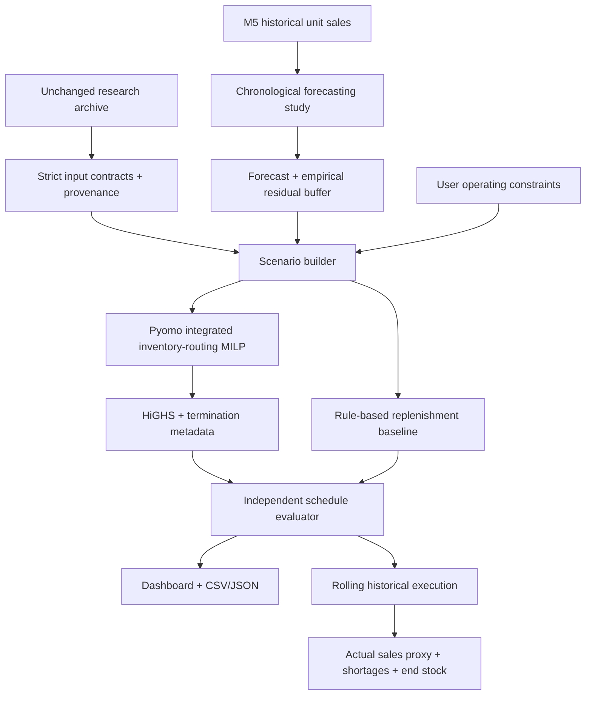

# Architecture and data flow

## Contracts

`Scenario` carries customers, vehicle characteristics, demand, depot supply, units, operating settings and provenance. `Plan` contains ordered depot-return routes and quantities, never UI-specific values. `evaluate()` independently rebuilds all stock balances and metrics from these objects.

Data modules do not import the solver or dashboard. Forecasting consumes only daily history preceding an origin. Simulation copies a common physical scenario, replacing stock with realised state and demand with the latest forecast. UI results are attached to a scenario fingerprint; changed inputs cannot silently relabel old results.

## Exact route enumeration choice

Instead of arc binaries and subtour cuts, the first implementation enumerates all nonempty customer subsets (31 for five outlets). Held–Karp dynamic programming finds each subset's shortest depot-return tour. A MILP selects these complete tours and their vehicle-specific delivery quantities together.

This is exact for the current distance-only model: both transport cost and emissions are nonnegative linear functions of route distance for a given vehicle, so a longer tour visiting the identical subset cannot improve either objective. There are no time windows or load-dependent fuel terms. If these are introduced, the route catalogue approach must be reconsidered. At ten outlets there are 1,023 subsets; larger cases are rejected explicitly.

## Intelligence

- Forecast candidate features: outlet index, day of week, month, lags 1/7/14/28, past 7/28-day means, past 28-day standard deviation.
- Pooled deterministic random forest; fixed hyperparameters and last 730 training observations per store. Multi-step predictions are recursive, never filled with future actuals.
- Three disjoint final 21-day windows: model selection, buffer calibration, held-out test. Each uses rolling 3-day origins.
- Buffer: nonnegative 90th percentile of calibration underprediction, rounded upward. This is an empirical heuristic, not a service-level guarantee.
- Simulation compares forecast methods using the same physical assumptions and buffer. The perfect-information reference sees only the same short future planning horizon; it is not a global optimum bound for the entire experiment.

## Current UI connections

Overview/replenishment/routes read one validated plan. Carbon comparison runs a separate collection of explicit scenarios. Forecasting reads actual historical data and saved study metrics. Performance reads the saved rolling execution report. Data & sources exposes the current parameter register. The point-forecast planning view and buffered historical simulation are labelled separately.
